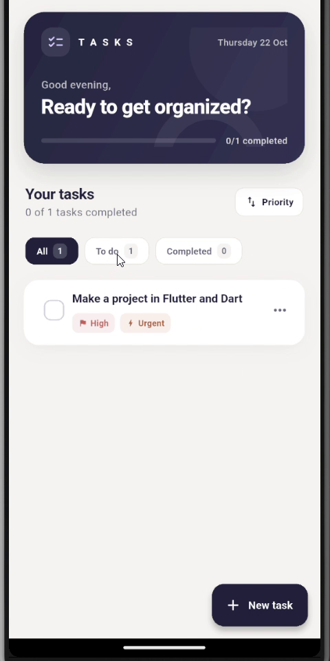

# Task List

Task List is a Flutter application for creating and organizing everyday tasks. It was built as Project 4 for the CognoRise InfoTech App Development Internship. The app supports priorities, due dates, completion tracking, and local persistence.

## Application demo

The preview below is a frame captured from the full walkthrough. Select it to open the video.

[](./20261022-2335-33.0347895.mp4)

The walkthrough is 1 minute 37 seconds long and demonstrates the task editor, priority and due-date selection, urgent tasks, filtering, completion, deletion confirmation, and undo. The MP4 is stored in this repository. GitHub's README view does not reliably embed repository MP4 files as inline players; selecting the preview opens the video file, where playback or download depends on the GitHub view and browser.

## Features

- Create tasks with a required title, priority, optional due date, and optional urgency level.
- Edit task details while preserving completion status.
- Mark tasks complete and return them to the pending list.
- Filter the list by all, pending, or completed tasks.
- Sort by priority or due date. Urgency level is considered before priority in priority sorting.
- Confirm deletion from the task menu or swipe action, then restore a deleted task with **Undo**.
- Display loading, empty, and recoverable error states.
- Store task data locally between app launches.
- Use an English interface, accessible completion labels, and subtle completion animations.

## Requirements

- Flutter SDK with a Dart SDK satisfying the constraint in [`pubspec.yaml`](./pubspec.yaml) (`^3.10.1`).
- Android Studio or Visual Studio Code with Flutter and Dart support.
- An Android emulator or device. An iOS simulator requires macOS.

## Run the application

Run these commands from the directory containing `pubspec.yaml`:

```sh
flutter pub get
flutter devices
flutter run
```

Run the automated tests and static analysis from the same directory:

```sh
flutter test
flutter analyze
```

## Project structure

```text
.
├── assets/
│   └── task-list-preview.png
├── bin/
│   └── task_manager.dart
├── lib/
│   ├── main.dart
│   ├── app_theme.dart
│   ├── exceptions/
│   ├── models/
│   ├── repositories/
│   ├── screens/
│   ├── services/
│   └── widgets/
├── test/
├── android/
├── ios/
├── web/
├── 20261022-2335-33.0347895.mp4
├── pubspec.yaml
└── README.md
```

### Application layers

- **Models** define the shared `Task` contract, `BasicTask`, `UrgentTask`, and the `Priority` enum. They also convert task data to and from JSON.
- **TaskFactory** reads the JSON `type` field and reconstructs the matching task subtype.
- **Repositories** provide a common CRUD contract. The Flutter app uses `SharedPreferencesTaskRepository`; `TaskRepository` stores JSON in a file and is used by the console application and related tests.
- **TaskService** validates input, creates and updates tasks, assigns IDs, sorts tasks, and changes completion state.
- **HomeScreen** loads and filters tasks, handles screen state, and connects user actions to the service.
- **TaskEditorSheet** gathers input and returns a `TaskDraft`. It does not write directly to storage.
- **TaskCard** renders an individual task and forwards edit, completion, and deletion actions to the screen.

### Saving a task

When a user saves the editor form, `TaskEditorSheet` returns a `TaskDraft`. `HomeScreen` passes its values to `TaskService`, which validates them and creates a `BasicTask` or `UrgentTask`. The Flutter repository serializes the task list as JSON and stores it in `shared_preferences` under the `tasks` key. When the list is loaded, `TaskFactory` uses each record's `type` field to restore the correct task model.

An urgent task is represented by data similar to:

```json
{
  "id": 1,
  "title": "Prepare the demo",
  "priority": "high",
  "dueDate": "2026-10-20T00:00:00.000",
  "completed": false,
  "urgencyLevel": 4,
  "type": "urgent"
}
```

## Tests

The test suite is organized by responsibility:

- `test/task_model_test.dart` checks JSON serialization for task models.
- `test/task_service_test.dart` checks task creation, title validation, completion, urgent tasks, sorting, and concurrent completion toggles.
- `test/task_repository_test.dart` checks file-based repository operations.
- `test/shared_preferences_task_repository_test.dart` checks local repository add, update, delete, and restoration when the repository is recreated using mocked preferences.
- `test/home_screen_test.dart` checks interface flows including create, edit, filters, delete confirmation, undo, and the five-second deletion message.

The persistence tests use mocked preferences. They do not terminate and relaunch a real device process. For a device-level check, create a task, fully close the app, reopen it, and confirm the task is still present.

## Privacy and security

Tasks are stored locally on the device. The app does not implement accounts, a backend, or cloud synchronization. `shared_preferences` is not encrypted storage, so do not store passwords, authentication codes, financial details, or other sensitive information in task data.

Before distributing an Android release, replace the example application ID with one owned by the publisher and configure a private release signing key. Do not commit signing keys or their passwords.

## Technology

- **Flutter and Dart** for the application and user interface.
- **Material 3** widgets for the interface components.
- **`shared_preferences`** for the Flutter app's local key-value storage.
- **JSON** for serializing and restoring task records.
- **`flutter_test` and `package:test`** for widget and unit tests.

## Reference

The project brief references [dwyl's Flutter Todo List tutorial](https://github.com/dwyl/flutter-todo-list-tutorial). Task List addresses the same broad task-management learning goals with its own service-and-repository structure and local persistence implementation.

## Limitations

- Tasks remain on one device; backup and synchronization are not implemented.
- `shared_preferences` is intended for small amounts of local data. A database such as SQLite or Drift would be more suitable for larger datasets or more advanced queries.
- Persistence is covered with mocked storage in automated tests; a real-device relaunch check remains useful.
- Android release signing and a publisher-specific application ID must be configured before app-store distribution.

## Learning concepts

The project demonstrates Flutter widget composition, form validation, asynchronous UI updates, Dart model types, JSON serialization, repository abstractions, local persistence, and automated widget and unit testing.

## License

This repository does not include a `LICENSE` file. No license for reuse or redistribution is specified.
